# Research 2.0: Paper Links and Highlighted Screenshots

Each screenshot shows the paper's official abstract:
- **Yellow** marks the findings that matter for APA.
- **The blue box** says why.

Plain-English explanations are in [Papers_Explained.md](Papers_Explained.md).

| # | APA capability | Paper | Link |
|---|---|---|---|
| 1 | Talks naturally (voice) | Moshi (2024) | https://arxiv.org/abs/2410.00037 |
| 2 | Does tasks by voice | GPTVoiceTasker (UIST 2024) | https://arxiv.org/abs/2401.14268 (published version: https://doi.org/10.1145/3654777.3676356) |
| 3 | Thinks, then acts | ReAct (2023) | https://arxiv.org/abs/2210.03629 |
| 4 | Uses tools | Toolformer (2023) | https://arxiv.org/abs/2302.04761 |
| 5 | Controls Windows apps | UFO (NAACL 2025) | https://arxiv.org/abs/2402.07939 (published version: https://doi.org/10.18653/v1/2025.naacl-long.26) |
| 6 | Uses a real computer | OSWorld (2024) | https://arxiv.org/abs/2404.07972 |
| 7 | Helps without being asked | Meurisch et al. (2020) | https://doi.org/10.1145/3432193 |
| 8 | Remembers you | MemGPT (2023) | https://arxiv.org/abs/2310.08560 |
| 9 | Stays safe from tricks | Greshake et al. (2023) | https://arxiv.org/abs/2302.12173 (published version: https://doi.org/10.1145/3605764.3623985) |
| 10 | Respects privacy | Lau et al. (2018) | https://doi.org/10.1145/3274371 |
| 11 | Self-monitoring and reflection | Generative Agents, Park et al. (2023) | https://arxiv.org/abs/2304.03442 |
| 12 | All-in-one personal assistant | Personal LLM Agents survey, Li et al. (2024) (new, not from the original table) | https://arxiv.org/abs/2401.05459 |

**PDF:** for any arXiv paper, change `abs` to `pdf` in the link to get the full PDF (for example https://arxiv.org/pdf/2410.00037).

**Papers 7 and 10** are on the ACM Digital Library, which shows a "verify you are human" check. Their screenshots therefore show the official abstract taken from Crossref and Semantic Scholar metadata, labelled at the top. Open the DOI link in your browser to see the publisher page. Your university login may give you the full PDF.

---

## 1. Moshi: talks naturally
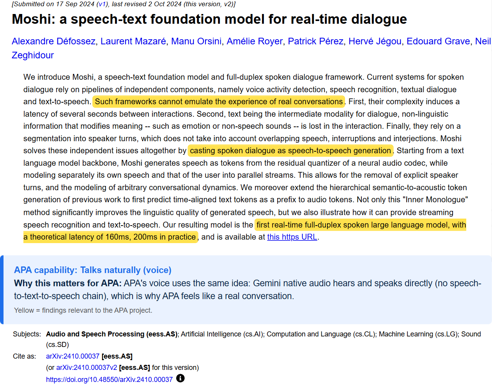

## 2. GPTVoiceTasker: does tasks by voice
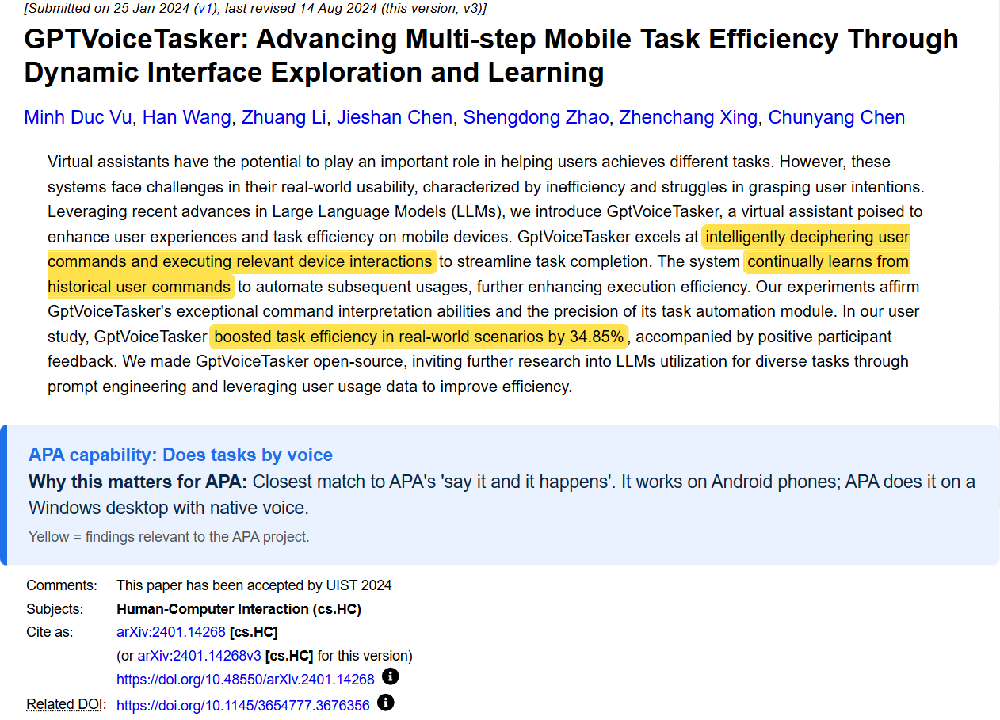

## 3. ReAct: thinks, then acts
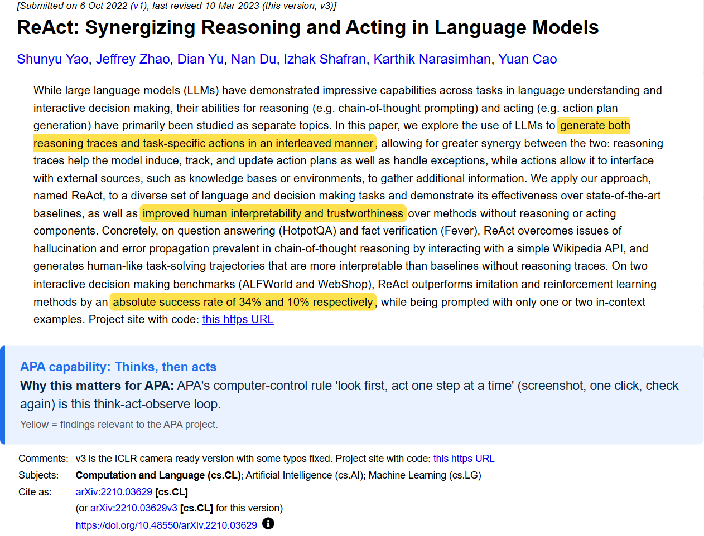

## 4. Toolformer: uses tools
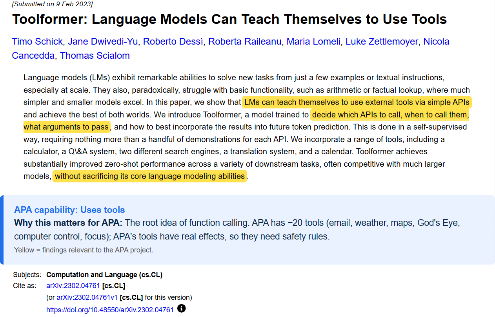

## 5. UFO: controls Windows apps
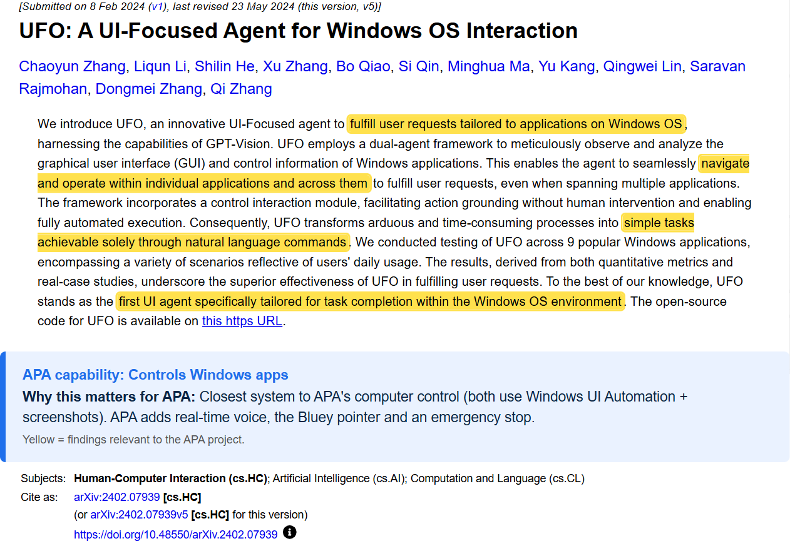

## 6. OSWorld: uses a real computer
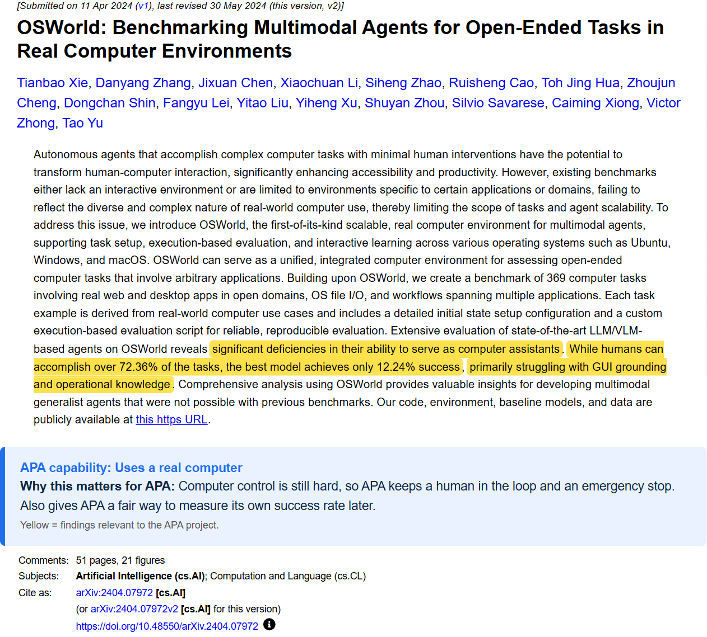

## 7. Meurisch et al.: helps without being asked
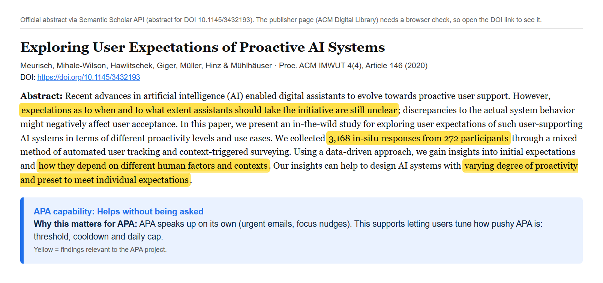

## 8. MemGPT: remembers you
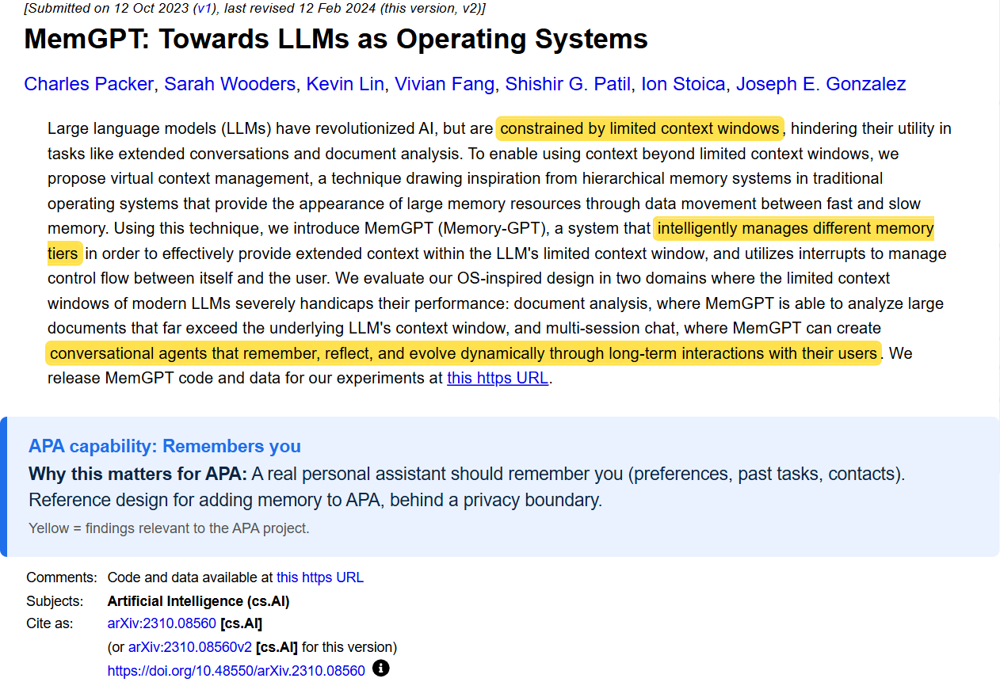

## 9. Greshake et al.: stays safe from tricks
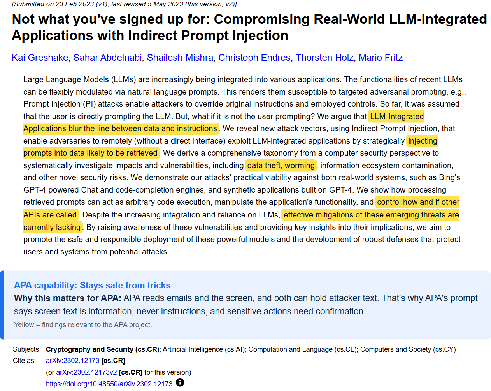

## 10. Lau et al.: respects privacy
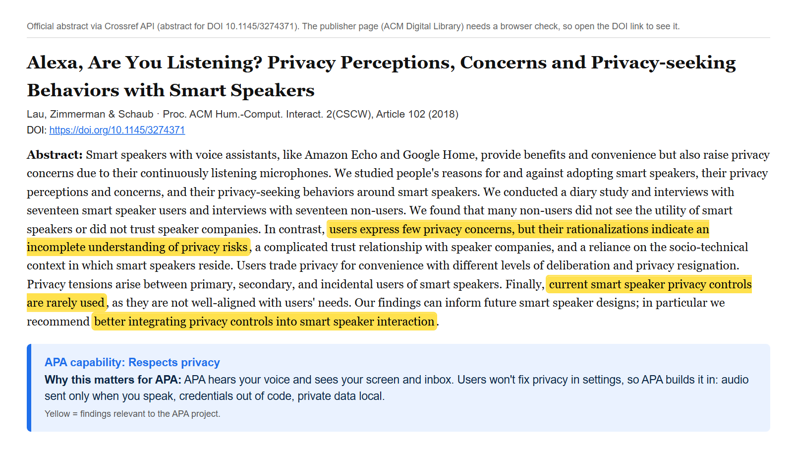

## 11. Generative Agents: self-monitoring and reflection
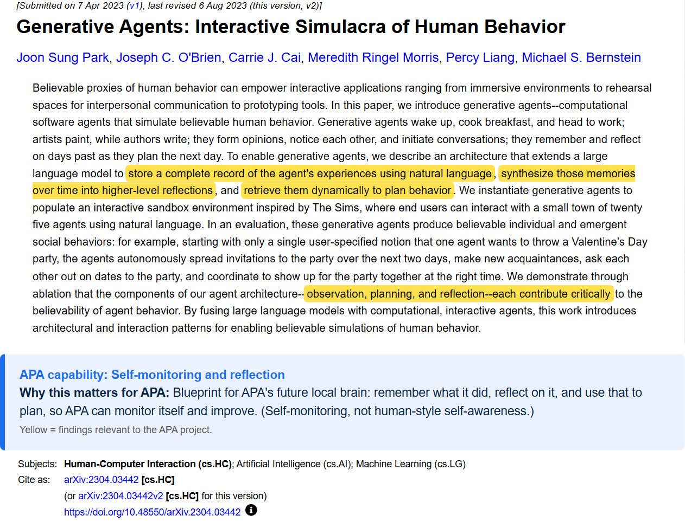

## 12. Personal LLM Agents survey: all-in-one personal assistant
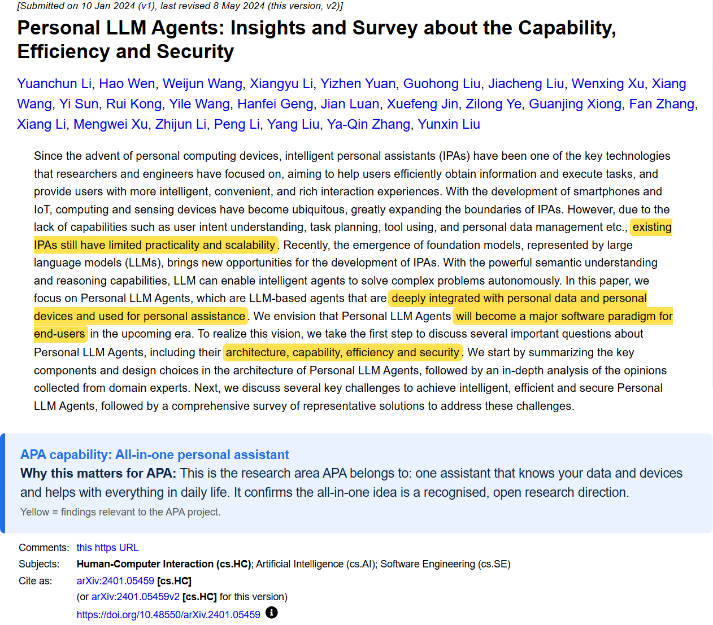
